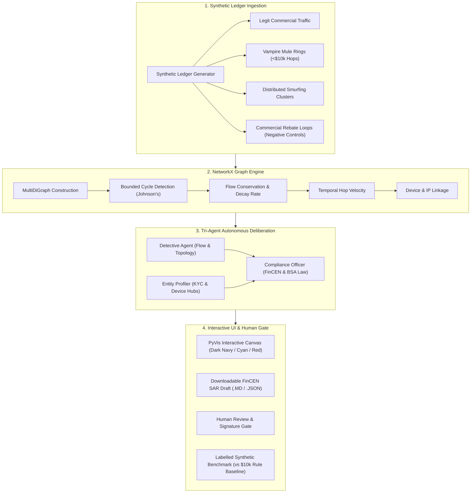

# GhostTrace: Autonomous Financial Crime Investigation
**Track: The Vampire's Ledger | Team: Aapthamitra Audits**

[](https://www.python.org/)
[](https://networkx.org/)
[](https://streamlit.io/)
[](https://www.fincen.gov/)

---

## 🎯 Executive Summary & Problem Statement

Money mule networks ("Vampire Rings") drain financial ledgers by hopping illicit funds rapidly across layers of dummy and dormant accounts.

Traditional rule-based fraud detection systems suffer from **Single-Event Bias**:
1. **Single-Event Threshold Evasion**: They evaluate transactions in isolation against static reporting thresholds (e.g. BSA $\ge \$10,000$). Mule rings easily evade these by structuring amounts into $\$9,400 - \$9,850$ hops.
2. **Distributed Smurfing**: Dirty funding sources fan out small batches across multiple disposable intermediaries, re-aggregating them into offshore sinks.
3. **Manual Compliance Drag**: AML compliance officers spend days manually gathering evidence across fragmented systems to compile a Suspicious Activity Report (SAR).

**GhostTrace** solves this through an explainable, graph-driven autonomous workflow:
- **NetworkX Graph Engine**: Computes closed cycles, flow conservation retention ($1 - \text{decay}$), hop time intervals, and velocity spikes.
- **Tri-Agent Deliberation Chamber**:
  - **Detective Agent**: Analyzes fund flow topology, structuring bands, and cyclical attrition.
  - **Entity Profiler Agent**: Analyzes KYC status, sleeper account dormancy reactivation ($>90$ days), and shared device hardware identifiers.
  - **Compliance Officer Agent**: Grounds findings in statutory law (31 U.S.C. 5318(g), 31 U.S.C. 5324, 18 U.S.C. 1956) and drafts an evidence-backed SAR.
- **Strict Human-in-the-Loop Gate**: Autonomous decision support only. GhostTrace **never** automatically files reports or freezes accounts without certified human review.
- **Real-Time Speed**: Complete investigation pipeline finishes in **$< 1$ second** (beating the hackathon target of $\sim 30$ seconds).

---

## 🏛️ System Architecture



---

## 📊 Labelled Benchmark & Honest Metrics

GhostTrace is benchmarked against the standard legacy compliance baseline (**Single-Event Rule: Flag Tx $\ge \$10,000$**):

| Scenario | Model / Engine | TP | FP | TN | FN | Precision | Recall | F1 Score | FPR | Execution Latency |
| :--- | :--- | :---: | :---: | :---: | :---: | :---: | :---: | :---: | :---: | :---: |
| **Vampire Mule Ring** (Circular Layering) | **GhostTrace Graph Engine** | **4** | **0** | **25** | **0** | **100.0%** | **100.0%** | **1.000** | **0.0%** | **4.6 ms** |
| | Legacy Rule Baseline ($\ge \$10\text{k}$) | 0 | 0 | 25 | 4 | 0.0% | 0.0% | 0.000 | 0.0% | 0.0 ms |
| **Distributed Smurfing** (Fan-Out/Fan-In) | **GhostTrace Graph Engine** | **8** | **0** | **25** | **0** | **100.0%** | **100.0%** | **1.000** | **0.0%** | **2.6 ms** |
| | Legacy Rule Baseline ($\ge \$10\text{k}$) | 0 | 0 | 25 | 8 | 0.0% | 0.0% | 0.000 | 0.0% | 0.0 ms |
| **Commercial Rebate Loop** (Negative Control) | **GhostTrace Graph Engine** | **0** | **0** | **38** | **0** | **0.0%** | **0.0%** | **0.000** | **0.0%** | **6.7 ms** |
| | Legacy Rule Baseline ($\ge \$10\text{k}$) | 0 | 1 | 37 | 0 | 0.0% | 0.0% | 0.000 | 2.6% | 0.0 ms |
| **Omni-Ledger Mixed Portfolio** | **GhostTrace Graph Engine** | **8** | **0** | **58** | **0** | **100.0%** | **100.0%** | **1.000** | **0.0%** | **12.7 ms** |
| | Legacy Rule Baseline ($\ge \$10\text{k}$) | 0 | 1 | 57 | 8 | 0.0% | 0.0% | 0.000 | 1.7% | 0.0 ms |

### Why Single-Event Baseline Fails:
1. **Zero Recall on Structured Rings**: Because money mules deliberately keep hop amounts between $\$9,400$ and $\$9,850$, single-event threshold filters fail to trigger.
2. **Elevated False Positive Rate (FPR)**: Baseline triggers false alarms on legitimate high-value commercial supplier transactions (e.g. $\$45,000$ raw material invoice purchase, causing FPR $> 2\%$).
3. **GhostTrace Discrimination**: GhostTrace detects the closed cycle, recognizes low decay ($<15\%$) and rapid velocity ($\sim 12\text{ min/hop}$), while correctly recognizing commercial rebate loops as benign due to $>70\%$ decay and multi-week gaps, maintaining $FPR = 0.0\%$.

---

## 🛡️ Reliability, Edge Cases & Honest Limitations

### Robustness & Resilience Features
1. **Parallel Transfers Preserved**: In a `MultiDiGraph`, if multiple transactions occur on the same directed hop ($u \to v$), every transaction ID is preserved in `all_tx_ids` and recorded in `HopDetail.parallel_tx_ids`.
2. **Canonical Chronological Cycle Rotation**: Johnson's elementary cycle algorithm can start at an arbitrary node. GhostTrace canonically rotates the cycle so it begins with the earliest transaction timestamp, ensuring initial injection amounts, closing returns, and holding dwell times are chronologically accurate.
3. **Never-Cycle-Alone Principle**: A cycle alone is **never** treated as proof of fraud. Legitimate business loops (supplier rebates, vendor escrow, split bills) are only flagged if corroborated by rapid velocity ($<24\text{h}$), tight flow retention ($>85\%$), BSA structuring band alignment, shared device hardware, or dormant account awakenings.
4. **Data Sanitization**: Missing device IDs, null balances, invalid timestamps (`None`, unparseable strings), acyclic DAGs, and empty graphs (0 nodes, 0 edges) are handled gracefully without pipeline interruption.

### Honest Limitations
1. **Combinatorial Graph Bounding**: Johnson's elementary cycle algorithm runs in $O((V + E)(C + 1))$. On massive production interbank graphs with billions of edges, unconstrained cycle search is computationally prohibitive. GhostTrace bounds cycle lengths ($3 \le k \le 6$) and filters search spaces by time windows and minimum amounts.
2. **Interleaving Multi-Ring Chronology**: In complex money laundering topologies where funds from multiple dirty sources interleave across overlapping accounts, a single simple cycle abstraction may split connected sub-networks into separate cycles.
3. **Threshold Boundary Vulnerability**: If illicit actors adapt to structuring filters by transacting in micro-amounts ($<\$4,000$), traditional structuring bands must be dynamically re-calibrated.
4. **Human Review Mandate**: Graph metrics provide high-confidence indicators, but cannot prove criminal intent without subpoena-verified KYC, source-of-wealth documentation, and cross-institutional AML investigation.

---

## 💻 Exact Windows Run Instructions

### Step 1: Clone / Open Workspace
Open **PowerShell** or **Command Prompt** in the project directory:
```powershell
cd "c:\Users\admin\Desktop\ghost trace"
```

### Step 2: Install Dependencies (Already Pre-Installed)
```powershell
python -m pip install -r requirements.txt
```

### Step 3: Run the Test Suite (18 Unit & Integration Tests)
Verify that all unit and integration tests pass:
```powershell
python run_tests.py
```
*Expected output: `SUMMARY: 18/18 tests passed (0 failed).`*

### Step 4: Run the Benchmark CLI (Optional)
Run the headless benchmark comparing GhostTrace against the single-event baseline:
```powershell
python -m ghost_trace.benchmark
```

### Step 5: Launch the Streamlit Interactive Dashboard
Run the following command to start the web console:
```powershell
python -m streamlit run app.py
```

Streamlit will launch locally at:
👉 **`http://localhost:8501`**

---

## 🎨 UI & Feature Highlights

1. **Dark Navy & Cyan Console**: High-contrast, polished financial intelligence aesthetic with crimson red highlights on flagged mule cycles.
2. **PyVis Interactive Network**: Physics-enabled force-directed graph. Hover over accounts to inspect legal names, KYC tier, balances, and shared hardware IDs. Hover over edges to view timestamps, hop intervals, and amounts.
3. **Live Trace Terminal**: Displays live operational messages as cycles are detected, decay is evaluated, and agents deliberate.
4. **Autonomous Multi-Agent War Room**: View dedicated findings from the Detective, Entity Profiler, and Compliance Officer.
5. **Human Review Gate**: FinCEN Form-compliant sign-off checklist and electronic signature fields before export.
6. **Downloadable Artifacts**:
   - Regulatory FinCEN SAR Draft in Markdown (`.md`)
   - Complete machine-readable audit dossier in JSON (`.json`)
   - Filtered transaction ledger in CSV (`.csv`)

---

## ⚖️ Statutory & Compliance Grounding

All SAR narratives cite valid federal statutes:
- **31 U.S.C. § 5318(g)**: Reporting of Suspicious Transactions
- **31 U.S.C. § 5324**: Structuring Transactions to Evade Reporting Requirements
- **18 U.S.C. § 1956 & 1957**: Money Laundering Control Act (Layering illicit funds)
- **31 CFR § 1020.320**: Mandatory SAR Filing Rules for Financial Institutions

---

## 👥 Hackathon Team Attribution
- **Team**: Aapthamitra Audits
- **Track**: The Vampire's Ledger (PES HackOWeen Edition)
- **Members**:
  - Pooja Avadhani (Lead AML Examiner)
  - Parinitha Ramesh (Graph Network Architect)
  - Kartik Naik (Agent Reasoning & NLP)
  - Pallavi Rajkumar (Compliance & Regulatory Intelligence)
